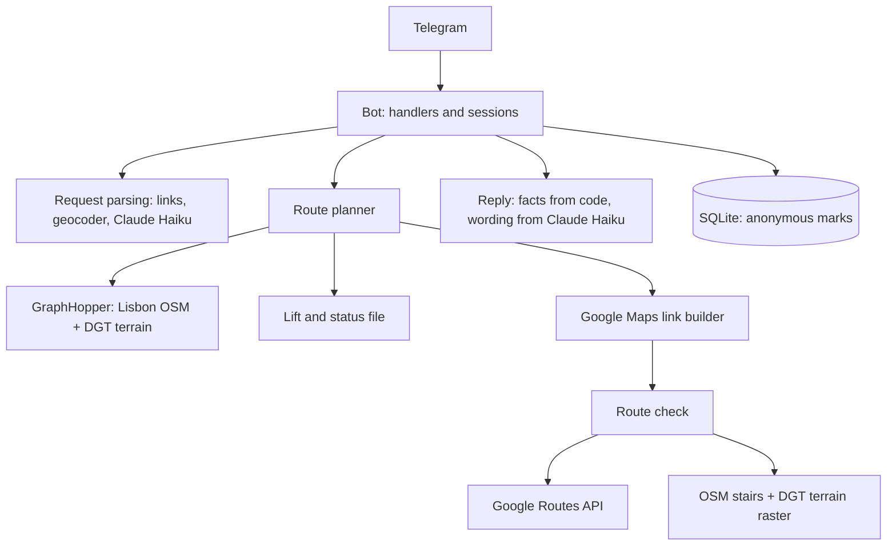
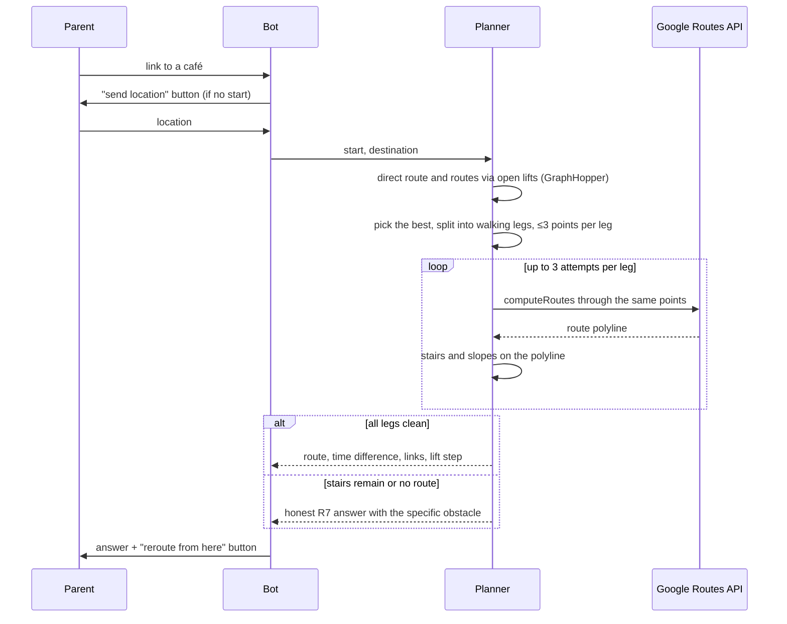

# Stroller Routes Lisbon - Plan

## Goal Capsule

- **Objective:** A parent with a stroller in Lisbon knows, before leaving home, which route gets them there without stairs or exhausting climbs, or knows honestly that no such route exists.
- **Means:** a non-commercial companion assistant next to Google Maps: it accepts a link to a place or a route, replies in text, and returns a suitable route as a Google Maps link.
- **Product authority:** the project author (primary user and first tester).
- **Authority hierarchy:** the Product Contract (R-IDs) decides behavior; Key Technical Decisions (KTDs) decide the mechanism within the Rs; units override neither.
- **Open blockers:** no planning blockers. U4 needs a Google Maps Platform key on a billing account with a Portuguese address (an author action, see Outstanding Questions).
- **Stop conditions:** if the U1 risk check fails (the router does not find stair-free routes that match the author's experience, Google links do not hold the route with ≤3 waypoints, or the route the Google Maps app draws when the link is tapped in Telegram differs from the computeRoutes polyline or drops waypoints), work stops after U1 with a report, and R6 and R10 go back to `ce-brainstorm` for revision.
- **Execution profile:** work happens on feature branches with pull requests to the public GitHub repository. U1 comes first and is the go/no-go gate before U2–U8.
- **Who finishes:** the executor (`ce-work`) builds and verifies U1–U8. The author walks the routes in U1 and the pilot, and sets up the keys (Telegram, Google, Anthropic), the DGT account for the elevation download, and the server.
- **Product Contract preservation:** restructured, no scope change: the deferred-to-planning questions "Channel", "Google route geometry for R2" and "Mark storage format" are resolved in KTD5, KTD4 and KTD10; the slope threshold moved to KTD9, tuned in U1.

---

## Product Contract

### Summary

A messenger assistant for parents with strollers in Lisbon.
Send it a destination and it builds a route with no stairs and no steep climbs, using the city's public lifts and funiculars, and returns it as a Google Maps link.
Send it a Google route and it shows where that route has stairs or a steep section and how to get around them.
After a walk, a parent can mark narrow sidewalks and bad surfaces with one tap, and these marks accumulate for later versions.

### Problem Frame

Google Maps builds the shortest walking route. In Lisbon that route often goes up staircase streets and steep slopes, even when a detour exists nearby: take a public lift up and walk downhill, or take a flat street that is slightly longer.
Google does have a "wheelchair accessible" mode, but it is designed for wheelchairs, works only where Google has data, and cannot prefer going downhill over going uphill.

The parent finds out mid-route, like a cyclist on a road bike who ends up on a gravel slope. The remaining options are all bad: carry the stroller up the steps, turn back, or walk in the road.
After a few such walks, parents start giving up simple plans in advance: a coffee, a visit to friends, a walk in another neighbourhood. Today's workarounds are: ask in a parents' chat, call ahead, carry the stroller, or not go.

Parents of young children are the primary audience because there are many of them and new ones arrive all the time. Tourists with suitcases and people with a temporary injury get the same benefit along the way.

### Key Decisions

- **Primary audience: parents with strollers.** Wheelchair users, tourists and people with injuries benefit along the way, but decisions are made for parents. (session-settled: user-directed — chosen over "all reduced-mobility groups equally": there are many parents and new ones arrive all the time.) Governs R1, R3.
- **Non-commercial project.** (session-settled: user-directed — chosen over finding a monetization model: monetization blocked the launch for years; building it matters more.)
- **A companion next to Google Maps, not its own map and not an embed.** Google Maps does not allow third-party code inside its app. An own map would mean re-teaching people. (session-settled: user-approved — chosen over an own map app, contributing data to Google itself, and a browser extension: habits stay the same and there is less code.) Governs R1, R2, R6.
- **Launch city: Lisbon.** A small capital with steep terrain and many children and tourists. (session-settled: user-directed — chosen by the user as the place for the first test.) Governs R4.
- **The first version handles stairs and slopes, and only collects narrow sidewalks and bad surfaces.** Reliable open data exists for stairs and slopes; for sidewalk width and surface there is almost none. (session-settled: user-approved — chosen over "all four obstacles at once through LLM photo analysis" and "stairs and slopes only, with no mark collection": a faster launch, and width and surface data accumulate from day one.) Governs R4, R5, R9.
- **Operating mode: build a route and check a Google route.** (session-settled: user-approved — chosen over "check the Google route only" and "a curated community collection of routes first": it addresses the "is there another way" pain, and the collection can grow out of the marks later.) Governs R2, R6, R7, R10.
- **Honesty over coverage.** If no suitable route exists, the assistant says so plainly and never presents a bad route as a good one. (session-settled: user-directed — the user chose the honest answer.) Governs R7.
- **The answer is measured against Google's suggestion, not against a fixed limit.** For every trip the assistant first takes the route Google suggests, then says one of three things: Google's route is already the most comfortable one found; there is a better way (no stairs, or a gentler climb) and what it costs in extra minutes; or there is no way without stairs. A slope limit is a tool for finding alternatives, not the definition of "suitable": in Lisbon a route under 8% often means a 10 km detour, which is useless. (session-settled: user-directed, 2026-11-27 — "our job is to differ from Google: how Google advises, whether it is the only comfortable way, or whether there is a better one". Found on the first real trips, `docs/research/spike-results.md`, Finding 8.) Governs R2, R4, R5, R7.
- **No turn-by-turn navigation of its own.** Google Maps does the navigation. The risk that Google reroutes is covered by a warning and fast rerouting, not by an own navigator. Governs R8.

### Actors

- A1. Parent with a stroller: sends a place or a route, walks the route, leaves marks.
- A2. Assistant: builds or checks the route, explains obstacles, accepts marks.
- A3. Google Maps: shows the route and navigates along it. The assistant does not control it.

### Requirements

**Request and reply**

- R1. A parent can send the assistant a Google Maps place link, an address, or a place name and get an answer without installing a separate map app.
- R2. A parent can send a route from Google Maps and the assistant checks that route: it names the stairs and steep sections on it with landmarks ("in 4 minutes — stairs on street X") and suggests a detour if one exists. If no obstacles are found, the assistant says "according to open data, I found no stairs or steep sections" rather than promising there are none.
- R3. The assistant replies in the language it was asked in.

**Building the route**

- R4. For a destination in Lisbon, the assistant compares Google's suggested walking route with stair-free alternatives built under several slope limits, from gentle to tolerant, and answers per the Key Decision on measuring against Google. Alternatives may use public lifts and funiculars as part of the route. Only lifts and funiculars from a manually verified list may be used (step-free entrance, strollers allowed, currently running). Every answer that includes a lift names a walking fallback in case it is closed.
- R11. If the start or end of the route is outside Lisbon, the assistant says plainly that it only works in Lisbon for now, and does not build a route.
- R5. When choosing between routes, the assistant prefers going downhill to going uphill and accepts a longer route for a flatter one. The answer says how many minutes longer the route is than Google's.
- R6. A suitable route is returned as a link that opens it in Google Maps through the assistant's waypoints, not along Google's shortest route. A route through a lift or funicular is returned as separate walking links before and after the ride, with the ride itself described in text.
- R10. Before sending, the assistant checks the route Google Maps will actually draw for that link, in the same way as in R2. If stairs or a steep section remain on it, the assistant does not call the route suitable and answers per R7.
- R7. If there is no route without stairs and steep climbs, the assistant says so plainly and offers the best remaining option with its specific obstacle (for example, "there is a route with one flight of 6 steps") or another way to get there (tram, lift, taxi).

**Leaving the route**

- R8. Together with the route, the assistant warns that if the parent leaves the route, Google will reroute its own way. The parent can send their current location and get a new route from there.

**Parent marks**

- R9. On the spot or right after, a parent can mark a place as "narrow" or "bad surface" with one tap or a photo. The place is confirmed with one button ("here" or "pick on map"). The first version collects these marks but does not yet use them for routing.

**Parents' data**

- R12. A mark stores only the place, the type and an approximate date, without the sender's messenger account. Metadata is stripped from photos; photos are kept only for internal review and are not shared anywhere. The parent is told this at their first mark.
- R13. Start points, destination addresses and live location are used only for the current answer and the short rerouting window of R8. They are passed to external routing services without a user identifier.

### Key Flows

- F1. Route to a place
  - **Trigger:** a parent sends a link to a café or a friend's address.
  - **Actors:** A1, A2, A3
  - **Steps:** the assistant asks for the start point if it is missing (location or address); builds the route; replies with a short description (time, difference from Google, lifts along the way) and a Google Maps link; adds the warning about leaving the route.
  - **Outcome:** the parent walks a stair-free route or knows in advance that none exists.
  - **Covered by:** R1, R4, R5, R6, R7, R8, R10, R11, R13
- F2. Checking a Google route
  - **Trigger:** a parent sends a route built by Google Maps.
  - **Actors:** A1, A2
  - **Steps:** the assistant finds stairs and steep sections on the route; names them with landmarks; suggests a detour or the route from F1.
  - **Outcome:** the parent knows where the Google route will be hard.
  - **Covered by:** R2, R5, R6
- F3. Marking a spot
  - **Trigger:** a parent runs into a narrow sidewalk or a bad surface.
  - **Actors:** A1, A2
  - **Steps:** the parent sends a mark or a photo; the assistant confirms the place and type with one button each; the assistant confirms the mark was saved.
  - **Outcome:** the mark is saved for future versions.
  - **Covered by:** R9, R12

### Acceptance Examples

- AE1. **Covers R4, R5, R6, R10.** **Given** Google's shortest route from Baixa to a café uphill goes up stairs and a public lift is nearby, **when** the parent sends the café link, **then** the assistant offers the route via the lift, says how many minutes longer it is, and gives a walking link to the lift, a text step "take the lift up" and a walking link from the lift, each of which passed the R10 check.
- AE2. **Covers R7.** **Given** a place in Alfama cannot be reached without stairs or steep climbs, **when** the parent asks for a route, **then** the assistant says plainly that there is no obstacle-free route and names the best option with its specific obstacle, or a tram, taxi or lift.
- AE3. **Covers R2.** **Given** a Google route contains one staircase, **when** the parent sends that route, **then** the assistant names the staircase with a landmark and suggests a detour if one exists.
- AE4. **Covers R8.** **Given** the parent took a wrong turn and Google rerouted through steps, **when** the parent sends their current location, **then** the assistant sends a new route from there.
- AE5. **Covers R3.** **Given** a tourist writes in English, **when** they ask for a route, **then** the whole answer is in English.

### Success Criteria

- The author and about 10 parents she knows in Lisbon use the assistant on real trips for a month.
- At least once that month, the assistant steers a parent away from stairs or a steep climb that Google would otherwise have sent them up.
- Parents find no cases where the assistant called a route suitable and it turned out to have stairs. Such cases matter more than any other error.

### Scope Boundaries

**Deferred for later**

- Using sidewalk width and surface in routing: once R9 marks accumulate or photo analysis appears.
- Accessibility inside venues: toilet, changing table, step-free entrance.
- A collection of parent-verified routes and walks with a community (a "Komoot for strollers" option).
- Other cities.
- A choice between "brisk" and "careful" modes with different slope thresholds.
- Contributing parent marks to OpenStreetMap so the data outlives the project.

**Outside this product's identity**

- An own map and own turn-by-turn navigation.
- Monetization.
- Strict wheelchair requirements (exact curb heights, doorway widths) as the main scenario.

### Dependencies / Assumptions

- OpenStreetMap stairs data in central Lisbon is complete enough for the R4 promise to hold. Not verified.
- Open elevation data gives street slopes accurately enough for the "too steep" threshold. Not verified.
- Lisbon's public lifts and funiculars, their locations, opening hours and stroller suitability can be collected and maintained by hand. Funiculars were closed for a long time after the Glória accident in September 2025, so their operating status needs checking. Not verified.
- A Google Maps link with waypoints keeps the route close enough to the assistant's route. The number of waypoints in a link is limited (about 9, about 3 in a mobile browser). Between waypoints Google picks its own path, hence the R10 check. A walking link cannot go through a lift or funicular.
- If Google launches its own stroller mode, that is a success for a non-commercial project, not a threat.

### Outstanding Questions

**Gates on the author (not blocking planning)**

- Set up a Google Cloud billing account with a Portuguese address so the EEA terms apply (KTD4), and set a daily request cap. Without it U4 is built and tested against a stub but does not go into the pilot.
- Create a free account at cdd.dgterritorio.gov.pt before U1 starts: without it the MDT 2 m elevation model cannot be downloaded. Login and password go in environment variables only.
- Get the Google key before U1: the computeRoutes call in U1 is mandatory (KTD4).
- Create the Telegram bot (BotFather), an Anthropic API key with a monthly spend limit, and a small server for the pilot (U8).

**Deferred to Implementation**

- The exact slope thresholds are tuned in U1 on the author's routes (starting values in KTD9).
- Whether GraphHopper reads the prepared DGT elevation file directly or needs a custom elevation loader (KTD3).

### Sources / Research

- Stair-free walking routes in Google Maps and place accessibility attributes: [blog.google](https://blog.google/company-news/outreach-and-initiatives/accessibility/making-daily-tasks-accessible/), [Android Authority](https://androidauthority.com/google-maps-wheelchair-accessible-routes-845961).
- Google Maps Platform offers APIs for building your own maps but no way to extend the Google Maps app: [documentation](https://developers.google.com/maps/documentation/javascript/libraries-open-source).
- Open routers on OpenStreetMap data: the choice is made in KTD1, the comparison is in `docs/research/2026-11-17-technical-research.md`.

---

## Planning Contract

### Key Technical Decisions

- KTD1. **Router: self-hosted GraphHopper on a Lisbon-only OSM extract, with a custom pedestrian model.** Stairs are forbidden outright (priority 0), slope is capped separately for uphill and downhill, and uphill is penalised more than downhill. Valhalla only offers soft penalties for steps, and OpenRouteService's slope limit does not distinguish uphill from downhill and relies on OSM tags that Lisbon barely has. GraphHopper's free hosted plan does not accept custom models, so an own server is needed. A second profile, "stairs allowed but expensive", is used only for the honest fallback of R7. (session-settled: user-approved — chosen over hosted OpenRouteService and Valhalla: the only way to forbid steps and tell uphill from downhill, at the cost of a server of about €5 a month.) Governs R4, R5.
- KTD2. **Lifts and funiculars are stitched in application code, not as graph edges.** The app builds the direct route plus composite routes with one or two open lifts in a row ("to lift A + A + from A to lift B + B + to the destination") and picks the best. Two lifts in a row are needed for the main climb Baixa → Castelo (Fanqueiros → Madalena, then Chão do Loureiro → Costa do Castelo). The lift list is kept by hand in one file: entrance and exit coordinates, hours, stroller suitability, date of last check. Funiculars are mapped in OSM as railways, which a pedestrian router does not use, and the manual list is needed anyway for operating status. Governs R4, R6.
- KTD3. **Slopes come from DGT's LiDAR terrain model (2 m, CC BY 4.0), not from global 30 m models.** Copernicus 30 m includes buildings and smooths out short steep streets. The model is clipped once to the Lisbon boundary and converted to a format GraphHopper reads; the route check (KTD4) uses the same raster. Slope is smoothed over a 10–20 m window, and elevation is interpolated on bridges. If GraphHopper cannot read the file, a custom elevation loader is written. (session-settled: user-approved — chosen over global 30 m models: they give wrong slopes in narrow streets.) Governs R4.
- KTD4. **Google route checks (R10, R2) use the Routes API computeRoutes in walking mode, matching the route polyline against OSM stairs and the KTD3 slopes.** A Google route link contains no polyline, only points, so the route is recomputed through the same points. The work runs under the EEA terms (billing address in Portugal): the polyline is not stored, not drawn on maps and not used to improve OSM or the graph; only a text verdict goes into the reply. A daily request cap is set. For its own links the assistant uses at most 3 waypoints per link and, if the check finds any obstacle (steps or a section steeper than the KTD9 threshold), moves or adds points and checks again, up to 3 attempts. For R2 the verdict covers the route Google builds through the same points, and the reply says so. Short `maps.app.goo.gl` links are expanded by following redirects to Google domains only. Governs R2, R6, R10.
- KTD5. **Pilot channel: a Telegram bot.** Free, no business registration, a "send location" button and inline buttons, phone numbers are not exposed. (session-settled: user-approved — chosen over the WhatsApp Cloud API: Meta business registration and charges for replies beyond 1,000 a month.) Governs R1, R8, R9.
- KTD6. **The LLM only parses the request and phrases the reply; regular code computes the facts.** Claude Haiku 5.5 (`claude-haiku-5-5`) extracts a fixed structure from free text (what was sent, the place, the language) and turns the finished structured result into text in the user's language. Routes, slopes, stairs and lift status are inserted into the reply from code; the LLM does not invent them. Links and coordinates are parsed by code before any LLM call. (session-settled: user-approved — chosen over free-form LLM generation of the reply: the assistant must not "make up" a route.) Governs R1, R3, R7.
- KTD7. **Stack: Python 3.12, `uv`, `python-telegram-bot`, `httpx`, `shapely`, `rasterio`, SQLite, `pytest`; GraphHopper and the bot run via Docker Compose.** One small service and one router process are simplest to keep on one server.
- KTD8. **Geocoding: first the Google link, then Nominatim with a cache and at most 1 request per second, then Photon as a typo-tolerant fallback; search is limited to the Lisbon bounding box.** A point outside the city triggers the R11 answer. Governs R1, R11.
- KTD9. **Starting slope thresholds: uphill no steeper than 8%, downhill no steeper than 10%, uphill penalised twice as much as downhill of the same grade.** The numbers are tuned in U1 on the author's routes and kept in one config shared by the router and the check. Governs R4, R5, R10.
- KTD10. **Personal data is short-lived and not tied to an account.** The conversation session (last start and destination, for R8) lives in process memory for 30 minutes. Coordinates are not written to logs. Marks live in SQLite with the fields: point, type, month and year; no Telegram identifier. EXIF metadata is stripped from photos; photos are stored locally and not uploaded anywhere. Who receives what: the router and Google get coordinates only; geocoders get the place text and the Lisbon bounding box; Claude Haiku gets the current message text and the fact structure with street, lift and place names. Telegram identifiers (user and chat) and raw start coordinates are never sent anywhere. The `httpx` and `httpcore` loggers run at WARNING, otherwise addresses, coordinates and the bot token would leak into logs from request URLs. Governs R9, R12, R13.

### High-Level Technical Design

Components and data flow:



Route to a place (F1) with link verification, a directional sketch:



### Output Structure

```text
stroller-routes-lisbon/
  pyproject.toml
  docker-compose.yml
  config/
    graphhopper.yml
    stroller-model.json
    thresholds.toml
    lifts.yaml
  data/                      # not in git: OSM extracts, terrain, SQLite, photos
  scripts/
    fetch_osm.sh
    prepare_elevation.py
    export_steps.py
  spike/
    spike_routes.py
    routes.yaml
  src/stroller/
    routing/planner.py
    routing/graphhopper.py
    routing/lifts.py
    verify/checker.py
    verify/google_routes.py
    links/build.py
    links/parse.py
    understand/geocode.py
    understand/llm.py
    bot/app.py
    bot/handlers.py
    bot/session.py
    bot/replies.py
    marks/store.py
  tests/
  docs/
    research/
    ops/pilot.md
```

### Assumptions

- OSM stairs data in central Lisbon is complete: 506 `highway=steps` ways, 80% with a direction (Overpass sample from 2026-11-17). Checked in U1.
- The computeRoutes polyline through the same points matches the route the Google Maps app draws when the link is tapped in Telegram, and the app keeps the waypoints. Checked in U1; a mismatch is a stop condition.
- The Google Maps Platform EEA terms apply to a billing account with a Portuguese address, and checking a route polyline without drawing or storing it complies with them.
- Requesting the polyline keeps a computeRoutes call in the Essentials tier (10,000 free a month). Not confirmed; the daily cap protects against an unexpected bill.
- The pilot sees no more than a few hundred requests a day; one bot process and one GraphHopper on a €5 server are enough.

### Risks & Dependencies

| Risk | What we do |
|---|---|
| Google builds a path with steps between the waypoints, and 3 points are not enough | R10 check with retries; U1 measures how often this happens; frequent failures trigger the stop condition |
| GraphHopper cannot read the DGT terrain | A custom elevation loader or precomputed slopes per edge (KTD3) |
| A lift closes without notice | Check date in the lift file, a monthly review in `docs/ops/pilot.md`, a walking fallback in every answer (R4) |
| Google's terms change | The check is isolated in one module, `verify/google_routes.py`; if it is no longer allowed, the bot switches to unverified answers with an explicit caveat; the author decides |
| Nominatim blocks us for too many requests | Cache, 1 request per second, Photon as a fallback |

---

## Implementation Units

### U1. Risk check on the author's routes (go/no-go gate)

**Goal:** before any work on the bot, find out whether the router finds stair-free routes that match the author's experience and whether Google Maps links hold them.

**Requirements:** R4, R5, R6, R10; Success Criteria; Dependencies / Assumptions on OSM and terrain data.

**Dependencies:** none.

**Files:**
- `scripts/fetch_osm.sh`
- `scripts/prepare_elevation.py`
- `config/graphhopper.yml`
- `config/stroller-model.json`
- `config/thresholds.toml`
- `spike/routes.yaml`
- `spike/spike_routes.py`
- `docs/research/spike-results.md`

**Approach:**
1. Download the Portugal OSM extract and clip the Lisbon bounding box; download the DGT 2 m terrain tiles for the same box and prepare them for GraphHopper (KTD3).
2. Run GraphHopper locally with the KTD1 model and the KTD9 thresholds.
3. The author writes 3–4 familiar routes into `spike/routes.yaml`: from, to, where the stairs actually are, and which way she walks with a stroller.
4. For each route the script builds the path, splits it into links with ≤3 waypoints (KTD4), and prints: length, time, maximum slope, the Google Maps link and a link to view the path on OSM.
5. For each link the script calls computeRoutes through the same points and prints the stairs and steep sections found on Google's polyline (the call is mandatory, KTD4).
6. The author sends the links to herself in Telegram, taps them on her phone, and records: whether the Google Maps app kept the waypoints, whether the drawn route matches the computeRoutes polyline, the assistant's route and her experience.
7. On routes with known stairs, the stair-matching rule is calibrated (buffer width and share of the stair length, U4).
8. Slope thresholds are adjusted, and the outcome is written to `docs/research/spike-results.md`: what matched, what did not, which thresholds were chosen, and the go/no-go decision.

**Execution note:** this is an exploratory unit: the check is manual and the code in `spike/` can be thrown away. The value of the unit is the recorded result and the chosen thresholds.

**Test expectation:** none -- an exploratory run; the proof is `docs/research/spike-results.md` with the author's verdict on each route.

**Verification:** for each of the 3–4 routes it is recorded whether the assistant's route matched the author's experience, whether the Google Maps app kept the waypoints when tapped from Telegram, and whether the drawn route matched the computeRoutes polyline; there is an explicit "go" or "stop" decision.

### U2. Project skeleton and router data

**Goal:** reproducibly build the Lisbon graph with terrain, the stairs list for the check and the lift file, and start GraphHopper with one command.

**Requirements:** R4, R5; KTD1, KTD2, KTD3, KTD7, KTD9.

**Dependencies:** U1 ("go" decision and chosen thresholds).

**Files:**
- `pyproject.toml`
- `docker-compose.yml`
- `.gitignore`
- `scripts/export_steps.py`
- `config/lifts.yaml`
- `src/stroller/config.py`
- `tests/test_config.py`

**Approach:**
1. Carry over from U1 the data-preparation scripts and configs that proved themselves.
2. `scripts/export_steps.py` exports OSM stairs (`highway=steps` ways) to a geometry file for the U4 check.
3. `config/lifts.yaml` is filled from the city's and EMEL's open data: for each lift its entrance, exit, hours, "stroller OK", "running", and check date. As of 2026-11-19 the running ones are the city lifts Baixa → Castelo (Fanqueiros → Madalena, Chão do Loureiro → Costa do Castelo), Sé, Portas do Sol and the Graça funicular; Santa Justa, Glória, Bica and Lavra are closed.
4. `src/stroller/config.py` reads thresholds, lifts and keys from one place; keys come from environment variables only.
5. `data/` is in `.gitignore`.

**Test scenarios:**
- A lift file with a lift missing its check date or its "stroller OK" flag does not load, and the error names the lift.
- A lift with `running: no` is not in the available list.
- A lift outside its hours (for example, Sé at 22:00) is not in the available list at that time.
- The thresholds in `config/thresholds.toml` are seen identically by the router and the check.

**Verification:** on a clean machine, GraphHopper and the tests come up from the README; a route request to GraphHopper returns a route in Lisbon.

### U3. Route planner with lifts and honest refusal

**Goal:** from a start and destination, return the best route with no stairs and no steep climbs, using lifts, or an honest refusal with the least bad option.

**Requirements:** R4, R5, R7, R11; F1; AE1, AE2; KTD1, KTD2, KTD8, KTD9.

**Dependencies:** U2.

**Files:**
- `src/stroller/routing/graphhopper.py`
- `src/stroller/routing/lifts.py`
- `src/stroller/routing/planner.py`
- `tests/routing/test_planner.py`
- `tests/routing/test_lifts.py`
- `config/stroller-stairs-fallback-model.json`
- `tests/fixtures/graphhopper/`

**Approach:**
1. The GraphHopper client requests a route in the "stroller" model and, separately, in the "stairs allowed but expensive" model for the honest fallback.
2. For lifts open at that time within 1.5 km of the straight start–destination line, composite routes with one or two lifts in a row are built (KTD2); a pair counts only if the walking leg between the lifts is itself passable in the "stroller" model.
3. The best route is chosen by time, including the uphill penalty (KTD9); the time difference is computed against an ordinary unrestricted walking route.
4. If no suitable route exists, the option with the fewest obstacles is returned, each one named: the number of steps or a section with its slope, plus a "tram, lift or taxi" hint (R7).
5. A point outside the Lisbon box gives an "outside the city" result without routing (R11).

**Patterns to follow:** the planner's result is a structure of facts (legs, lifts, obstacles, time) from which the text and links are assembled later; the planner does not write text (KTD6).

**Test scenarios:**
- Covers AE1. The direct route has stairs and an open lift is nearby: the route via the lift is chosen, the time difference is greater than zero, and the lift step is named.
- A request from Baixa to Costa do Castelo: the chain Fanqueiros → Madalena, then Chão do Loureiro → Costa do Castelo is chosen, with two lift steps.
- The same case as AE1 but the lift is closed: no route via the lift is offered; a flat detour or an honest refusal is chosen.
- Covers AE2. Neither a direct route nor a route via a lift exists: the result is "no route" plus the least bad option with its number of steps.
- Two routes of equal length, one with a 7% climb and one with a 7% descent: the descent is chosen.
- Start in Lisbon, destination in Sintra: the result is "outside the city", and GraphHopper is not called.
- GraphHopper is unavailable: the error "router unavailable", not an empty route presented as "no route".

**Verification:** tests on recorded GraphHopper responses pass; on the 3–4 routes from U1 the planner gives the same routes as the spike.

### U4. Google Maps links and Google route verification

**Goal:** turn the assistant's route into verified walking links, and check a submitted Google route for stairs and steep sections.

**Requirements:** R2, R6, R10; F2; AE1, AE3; KTD3, KTD4, KTD9.

**Dependencies:** U2, U3.

**Files:**
- `src/stroller/links/build.py`
- `src/stroller/links/parse.py`
- `src/stroller/verify/checker.py`
- `src/stroller/verify/google_routes.py`
- `tests/links/test_build.py`
- `tests/links/test_parse.py`
- `tests/verify/test_checker.py`
- `tests/verify/test_google_routes.py`
- `tests/fixtures/google/`

**Approach:**
1. `links/build.py` splits the route into walking legs at lifts (one link per leg between lifts) and picks at most 3 waypoints per leg where the assistant's route departs from the shortest one.
2. `verify/checker.py` takes a route polyline and finds: OSM stairs the line runs along (most of the stair's length, 50% to start with, lies within a buffer of about 10 m of the line and the bearing roughly matches; mere proximity does not count), and sections with a slope above the threshold from the DGT raster (smoothing window from KTD3). The buffer and share are calibrated in U1.
3. `verify/google_routes.py` calls computeRoutes with the same points in walking mode and passes the polyline straight to the check, storing nothing (KTD4).
4. The R10 loop: if any obstacle (a step or a steep section) is found on Google's polyline, a point is moved towards the assistant's route and the check repeats, up to 3 times; if that fails, the result is "could not hold the route", which the bot answers per R7.
5. `links/parse.py` expands `maps.app.goo.gl` only through redirects to Google domains, and extracts the start, destination, waypoints and mode; anything else gives "could not read the link".
6. For R2 the recomputed Google route is checked by the same `checker`; "clean" is phrased as "according to open data, found none" (R2).

**Test scenarios:**
- Covers AE1. A route with a lift gives two walking links and a lift step; each link has at most 3 points.
- A line running along a recorded OSM staircase gives a "stairs" obstacle with its approximate distance from the start.
- A line that passes the bottom end of a staircase or crosses its edge without using it: no obstacle.
- A line parallel to a staircase and offset by 7 m (Google and OSM geometry diverging): a "stairs" obstacle.
- A route with two lifts gives three walking links and two lift steps.
- The first check finds a steep section, and after moving a point the line is clean: the result is "verified".
- A line on a street with a 12% slope over 40 m with an 8% threshold gives a "steep climb" obstacle; a 3 m spike from raster noise is not an obstacle.
- The first check finds a step, and after moving a point the line is clean: the result is "verified", on the second attempt.
- Three attempts in a row with a step: the result is "could not hold the route".
- Covers AE3. A submitted Google route with one staircase: the obstacle is named and a detour from U3 is offered.
- A clean Google route: the verdict "according to open data, found none".
- A short link redirecting to a non-Google domain: the redirect is not followed, and the error is "could not read the link".
- No Google key configured: the check returns "verification unavailable", and the bot does not call the route verified.

**Verification:** tests on recorded Routes API responses and raster fragments pass; no module writes a Google route polyline to disk.

### U5. Understanding the request and wording the reply

**Goal:** understand what the parent sent, and turn the planner's facts into a short answer in their language.

**Requirements:** R1, R3, R7, R11; AE5; KTD6, KTD8.

**Dependencies:** U3, U4.

**Files:**
- `src/stroller/understand/geocode.py`
- `src/stroller/understand/llm.py`
- `src/stroller/bot/replies.py`
- `tests/understand/test_geocode.py`
- `tests/understand/test_llm.py`
- `tests/bot/test_replies.py`

**Approach:**
1. Parsing order: Google link (U4) → coordinates → the LLM extracts the request type, place text and language → geocoder (KTD8).
2. Several matches for a name give up to 3 options as buttons.
3. Reply language: the language of the text; if there is no text (only a link), the language of earlier messages, then the Telegram interface language, then English.
4. `replies.py` assembles the answer from facts: time, difference from Google, lifts, obstacles, links, and the leaving-the-route warning (R8); the LLM only translates and links the phrases, while numbers and names are inserted from the facts.

**Test scenarios:**
- "Кафе Fábrica Coffee Roasters, Rua das Flores" in Russian gives a place request with language RU.
- Covers AE5. A message in English: the whole answer is in English, and the numbers match the planner's facts.
- Only a link, from a new user whose Telegram interface is in Portuguese: the answer is in Portuguese.
- A name with three matches in Lisbon: three buttons, and no route is built until one is chosen.
- An LLM answer whose minute count does not match the facts: the answer is rejected and assembled from a template without the LLM.
- Nominatim returns an error: Photon is used.
- The LLM request contains no Telegram identifiers and no raw start coordinates (KTD10).

**Verification:** tests pass on recorded LLM and geocoder responses; assembled answers contain no numbers or names that are not in the facts.

### U6. Telegram bot: route, route check, rerouting

**Goal:** guide a parent through F1 and F2 in Telegram, one-handed.

**Requirements:** R1, R2, R8, R11, R13; F1, F2; AE4; KTD5, KTD10.

**Dependencies:** U5.

**Files:**
- `src/stroller/bot/app.py`
- `src/stroller/bot/handlers.py`
- `src/stroller/bot/session.py`
- `tests/bot/test_handlers.py`
- `tests/bot/test_session.py`

**Approach:**
1. At first contact the bot briefly says what it does and which services receive the request text and points (Google, Anthropic, OpenStreetMap services), without linking them to an account (R13). The notice about how marks are stored is shown at the first mark (R12, U7).
2. No start point: a "send location" button and a "type an address" option.
3. A route answer has a "reroute from here" button that requests the current location with one tap (R8).
4. The session (start, destination, language) lives in memory for 30 minutes, coordinates are not logged, and the `httpx` and `httpcore` loggers run at WARNING (KTD10).
5. Router, geocoder and Google errors become an honest "I can't check right now", not an unverified route.

**Test scenarios:**
- Covers F1. A café link with no start → location button → location → an answer with the route, links and the "reroute from here" button.
- Covers AE4. 10 minutes after the answer, "reroute from here" is tapped with a new location: a new route from there to the same destination.
- The same button after 40 minutes: the bot asks for the destination again; the old coordinates are gone.
- Covers F2. A submitted Google route link: an answer with the obstacles found, or "according to open data, found none".
- An address outside Lisbon: the answer "Lisbon only for now" (R11).
- After a full scenario, the logs of all loggers (including `httpx`) at production level contain no coordinates, addresses or bot token.

**Verification:** handler tests on fake Telegram updates pass; a manual run in a test bot through the AE1 scenario.

### U7. Anonymous parent marks

**Goal:** let a parent mark "narrow" or "bad surface" on the spot with one button, and store the mark without linking it to a person.

**Requirements:** R9, R12; F3; KTD10.

**Dependencies:** U6.

**Files:**
- `src/stroller/marks/store.py`
- `src/stroller/bot/handlers.py`
- `tests/marks/test_store.py`
- `tests/bot/test_marks_flow.py`

**Approach:**
1. A mark starts from a menu button or a sent photo.
2. The place is confirmed with a "here" button (a Telegram button that requests the location) or "pick on map": Telegram has no point-picker button, so the bot says in one line to send a point via "Attach → Location" and drag the pin; the next location message in the mark flow is taken as the place. The type is chosen with "narrow" and "bad surface" buttons.
3. SQLite stores the point, type, month and year; the Telegram identifier is not stored (KTD10).
4. Photo metadata is stripped before saving to `data/photos/`; photos are linked to the mark, not to the person.
5. At the first mark the bot says once what is stored and how.

**Test scenarios:**
- Covers F3. A photo without coordinates → "here" button with location → type "narrow": one record in the database with the point, type and month.
- Neither the record nor the photo file contains a Telegram identifier or EXIF with GPS.
- A mark without a confirmed place is not saved.
- After "pick on map", a location sent as an attachment is saved as the mark's point.
- The data-storage notice is shown only at the first mark.

**Verification:** tests pass; an export of the marks table has no fields that could identify a person.

### U8. Pilot launch

**Goal:** run the bot and the router on a server for the author and ~10 parents, and describe how to maintain them.

**Requirements:** Success Criteria; R4 (lifts kept up to date); KTD4, KTD7.

**Dependencies:** U6, U7.

**Files:**
- `docker-compose.yml`
- `docs/ops/pilot.md`
- `README.md`

**Approach:**
1. Docker Compose starts GraphHopper with the prebuilt graph and the bot; data and SQLite live in a persistent volume.
2. `docs/ops/pilot.md`: which keys are needed and where to get them, how to set the Google daily cap and the Anthropic monthly spend limit, how to review `config/lifts.yaml` monthly, how to rebuild the graph when OSM updates, and what to do if a parent reports stairs that were not in the answer.
3. README: local setup and tests.

**Execution note:** mostly configuration and launch: the proof is a live answer from the bot on the server, not unit tests.

**Test expectation:** none -- deployment configuration; verified by a manual launch.

**Verification:** the bot on the server answers the U1 routes the same way as locally; after a server restart, the graph and marks are still there.

---

## Verification Contract

- `uv run pytest` — all U2–U7 tests pass without network: GraphHopper, the Routes API, geocoders and the LLM are replaced by recorded responses from `tests/fixtures/`.
- `uv run ruff check` — no errors.
- Manual check: the U1 result is recorded in `docs/research/spike-results.md` with a "go" decision; scenarios AE1–AE5 are walked through in a test Telegram bot.
- A code search finds no writes of a Google route polyline to disk and no coordinates written to logs.

---

## Definition of Done

- U1 is finished with a "go" decision; otherwise work stops per the stop condition, with a report.
- U2–U8 are implemented, each with its Verification satisfied.
- All Verification Contract checks pass.
- Every requirement R1–R13 is covered by at least one unit or test.
- The repository has no code from abandoned attempts, except the clearly marked `spike/`.
- The bot runs on the pilot server, and `docs/ops/pilot.md` covers keys, limits and the monthly lift review.
