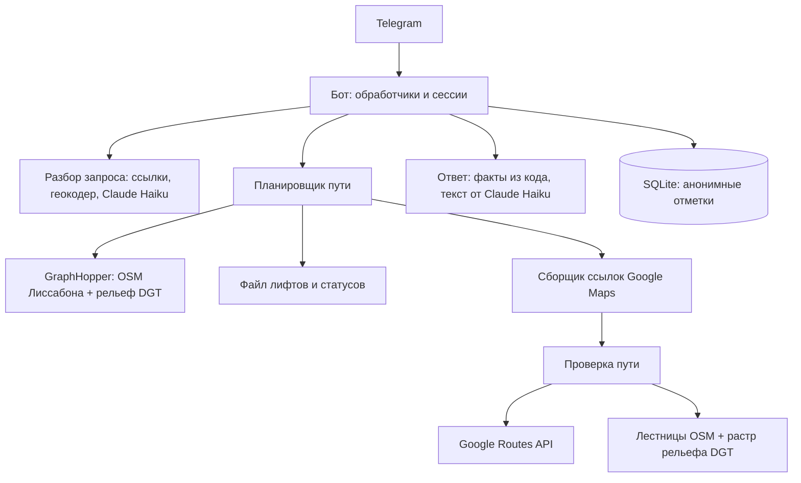
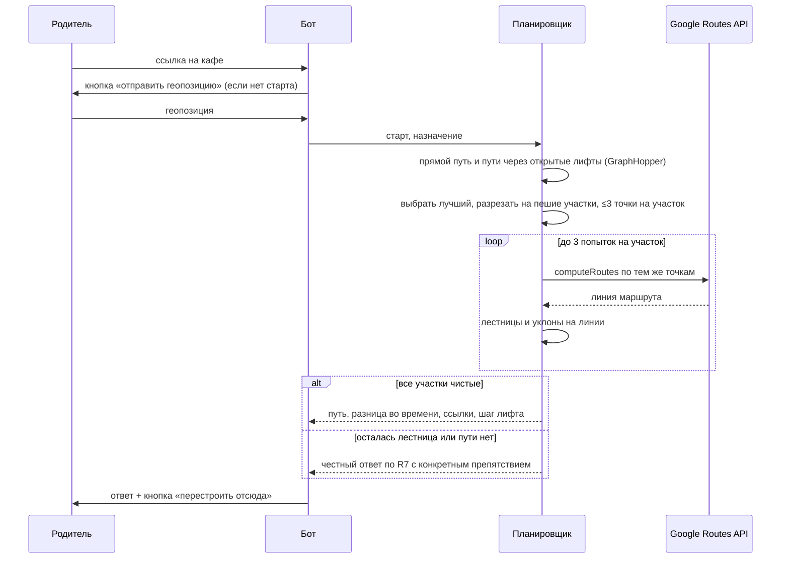

# Stroller Routes Lisbon - Plan

## Goal Capsule

- **Objective:** Родитель с коляской в Лиссабоне перед выходом из дома знает, по какому пути он дойдёт без лестниц и изнуряющих подъёмов, или честно знает, что такого пути нет.
- **Means:** некоммерческий помощник-компаньон рядом с Google Maps: принимает ссылку на место или маршрут, отвечает текстом и возвращает подходящий путь ссылкой в Google Maps.
- **Product authority:** автор проекта (основная пользовательница и первый тестировщик).
- **Authority hierarchy:** Product Contract (R-ID) решает поведение; Key Technical Decisions (KTD) решают механизм в рамках R; юниты не переопределяют ни то, ни другое.
- **Open blockers:** нет блокеров планирования. Для U4 нужен ключ Google Maps Platform с биллинговым аккаунтом на португальский адрес (действие автора, см. Open Questions).
- **Stop conditions:** если проверка рисков U1 не прошла (маршрутизатор не находит пути без лестниц, совпадающие с опытом автора, ссылки Google не удерживают путь при ≤3 промежуточных точках, или путь, который рисует приложение Google Maps при нажатии ссылки в Telegram, расходится с линией computeRoutes либо теряет промежуточные точки), работа останавливается после U1 с отчётом, а R6 и R10 возвращаются на пересмотр в `ce-brainstorm`.
- **Execution profile:** одна ветка и, когда подключат GitHub, один PR. U1 идёт первым и является точкой «идём или нет» перед U2–U8.
- **Who finishes:** исполнитель (`ce-work`) строит и проверяет U1–U8 локально. Автор проходит маршруты в U1 и пилоте, заводит ключи (Telegram, Google, Anthropic), учётную запись DGT для скачивания рельефа и сервер.
- **Product Contract preservation:** restructured, no scope change: вопросы «Канал», «Геометрия маршрута Google для R2» и «Формат хранения отметок» из Deferred to Planning решены в KTD5, KTD4 и KTD10; порог уклона перенесён в KTD9 с настройкой в U1.

---

## Product Contract

### Summary

Помощник в мессенджере для родителей с колясками в Лиссабоне.
Если прислать место назначения, он строит путь без лестниц и крутых подъёмов, используя городские лифты и фуникулёры, и отдаёт его ссылкой в Google Maps.
Если прислать маршрут Google, он показывает, где на нём лестница или крутой участок и как их обойти.
После прогулки родитель одним касанием отмечает узкие тротуары и плохое покрытие, и эти отметки копятся для следующих версий.

### Problem Frame

Google Maps строит кратчайший пеший путь. В Лиссабоне он часто идёт по лестницам-улицам и крутым склонам, хотя рядом есть обход: подняться на публичном лифте и спуститься с горы, или пройти по ровной улице чуть длиннее.
Режим «без ступенек» у Google есть, но он рассчитан на коляски для людей с инвалидностью, работает только там, где у Google есть данные, и не умеет предпочитать спуск подъёму.

Родитель узнаёт об этом уже на маршруте: как велосипедист на шоссейнике, который оказался на гравийном склоне. Дальше остаются плохие варианты: нести коляску по ступеням, разворачиваться или идти по проезжей части.
Опыт таких прогулок приводит к тому, что родители заранее отказываются от простых планов: кофе, поход в гости, прогулка в другой район. Сегодня обходные пути такие: спросить в родительском чате, позвонить, нести коляску на руках или не пойти.

Родители с маленькими детьми выбраны основной аудиторией, потому что их много и они появляются постоянно. Туристы с чемоданами и люди с временной травмой получают ту же пользу попутно.

### Key Decisions

- **Основная аудитория: родители с колясками.** Колясочники, туристы и люди с травмой получают пользу попутно, но решения принимаются под родителей. (session-settled: user-directed — chosen over «все маломобильные группы одинаково»: родителей много, и они появляются постоянно.) Governs R1, R3.
- **Некоммерческий проект.** (session-settled: user-directed — chosen over поиска модели монетизации: монетизация годами блокировала запуск, важнее сделать.)
- **Компаньон рядом с Google Maps, а не своя карта и не встраивание.** Google Maps не позволяет встраивать чужой код в своё приложение. Своя карта означала бы переучивать людей. (session-settled: user-approved — chosen over своего приложения с картой, наполнения данных самого Google и расширения для браузера: привычки не меняются, кода меньше.) Governs R1, R2, R6.
- **Город запуска: Лиссабон.** Небольшая столица с сильным рельефом, большим числом детей и туристов. (session-settled: user-directed — выбрано пользователем как место первой проверки.) Governs R4.
- **Первая версия учитывает лестницы и уклоны, а узкие тротуары и покрытие пока только собирает.** Для лестниц и уклонов есть надёжные открытые данные, для ширины тротуаров и покрытия их почти нет. (session-settled: user-approved — chosen over «все четыре препятствия сразу через анализ фото нейросетью» и «только лестницы и уклоны без сбора отметок»: быстрее запуск, а данные о ширине и покрытии копятся с первого дня.) Governs R4, R5, R9.
- **Режим работы: построить путь и проверить маршрут Google.** (session-settled: user-approved — chosen over «только проверка маршрута Google» и «сразу подборка проверенных путей с сообществом»: закрывает боль «есть ли другой сценарий», подборка вырастет из отметок позже.) Governs R2, R6, R7, R10.
- **Честность важнее покрытия.** Если подходящего пути нет, помощник говорит об этом прямо и не выдаёт плохой путь за хороший. (session-settled: user-directed — пользователь выбрал честный ответ.) Governs R7.
- **Своей пошаговой навигации нет.** Навигацию ведёт Google Maps. Риск того, что Google перестроит маршрут, закрывается предупреждением и быстрым перестроением, а не своим навигатором. Governs R8.

### Actors

- A1. Родитель с коляской: присылает место или маршрут, идёт по пути, оставляет отметки.
- A2. Помощник: строит или проверяет путь, объясняет препятствия, принимает отметки.
- A3. Google Maps: показывает путь и ведёт по нему. Помощник им не управляет.

### Requirements

**Запрос и ответ**

- R1. Родитель может прислать помощнику ссылку на место из Google Maps, адрес или название места и получить ответ без установки отдельного приложения с картой.
- R2. Родитель может прислать маршрут из Google Maps, и помощник проверяет именно его: называет лестницы и крутые участки на нём с ориентирами («через 4 минуты — лестница на улице X») и предлагает обход, если он есть. Если препятствий не найдено, помощник говорит «по открытым данным лестниц и крутых участков не нашёл», а не обещает, что их нет.
- R3. Помощник отвечает на языке, на котором его спросили.

**Построение пути**

- R4. Для места назначения в Лиссабоне помощник строит пеший путь без лестниц и без участков круче порога, допуская публичные лифты и фуникулёры как часть пути. Использовать можно только лифты и фуникулёры из проверенного вручную списка (вход без ступенек, коляску пускают, сейчас работает). Каждый ответ с подъёмом называет пеший запасной вариант на случай, если подъём закрыт.
- R11. Если начало или конец пути за пределами Лиссабона, помощник прямо говорит, что пока работает только в Лиссабоне, и путь не строит.
- R5. При выборе между путями помощник предпочитает спуск подъёму и согласен на более длинный путь ради более ровного. В ответе он сообщает, на сколько минут путь длиннее варианта Google.
- R6. Подходящий путь отдаётся ссылкой, которая открывает его в Google Maps по точкам помощника, а не по кратчайшему пути Google. Путь через лифт или фуникулёр отдаётся отдельными пешими ссылками до и после подъёма, а сам подъём описан текстом.
- R10. Перед отправкой помощник проверяет путь, который Google Maps на самом деле проложит по этой ссылке, тем же способом, что и в R2. Если на нём остаётся лестница или крутой участок, помощник не называет путь подходящим и отвечает по R7.
- R7. Если пути без лестниц и крутых подъёмов нет, помощник говорит об этом прямо и предлагает лучший из оставшихся вариантов с конкретным препятствием (например, «есть путь с одной лестницей из 6 ступенек») или другой способ добраться (трамвай, лифт, такси).

**Сход с маршрута**

- R8. Вместе с путём помощник предупреждает, что при сходе с маршрута Google поведёт своим путём. Родитель может прислать текущую геопозицию и получить новый путь от неё.

**Отметки родителей**

- R9. На месте или сразу после родитель может одним касанием или фотографией отметить место как «узко» или «плохое покрытие». Место подтверждается одной кнопкой («здесь» или «выбрать на карте»). Первая версия собирает эти отметки, но ещё не учитывает их при построении пути.

**Данные родителей**

- R12. Отметка хранит только место, тип и примерную дату, без аккаунта отправителя в мессенджере. Из фото удаляются метаданные, фото остаются только для внутренней проверки и никуда не передаются. При первой отметке родителю об этом сообщают.
- R13. Точки старта, адреса назначения и живая геопозиция используются только для текущего ответа и короткого окна перестроения по R8. Во внешние сервисы построения маршрутов они передаются без идентификатора пользователя.

### Key Flows

- F1. Путь к месту
  - **Trigger:** родитель присылает ссылку на кафе или адрес друзей.
  - **Actors:** A1, A2, A3
  - **Steps:** помощник уточняет точку старта, если её нет (геопозиция или адрес); строит путь; отвечает кратким описанием (время, разница с Google, лифты по пути) и ссылкой в Google Maps; добавляет предупреждение о сходе с маршрута.
  - **Outcome:** родитель идёт по пути без лестниц или заранее знает, что такого нет.
  - **Covered by:** R1, R4, R5, R6, R7, R8, R10, R11, R13
- F2. Проверка маршрута Google
  - **Trigger:** родитель присылает маршрут, который построил Google Maps.
  - **Actors:** A1, A2
  - **Steps:** помощник находит лестницы и крутые участки на маршруте; называет их с ориентирами; предлагает обход или путь из F1.
  - **Outcome:** родитель знает, где на маршруте Google будет тяжело.
  - **Covered by:** R2, R5, R6
- F3. Отметка на месте
  - **Trigger:** родитель сталкивается с узким тротуаром или плохим покрытием.
  - **Actors:** A1, A2
  - **Steps:** родитель отправляет отметку или фото; помощник одной кнопкой подтверждает место и тип; помощник подтверждает приём.
  - **Outcome:** отметка сохранена для будущих версий.
  - **Covered by:** R9, R12

### Acceptance Examples

- AE1. **Covers R4, R5, R6, R10.** **Given** кратчайший путь Google от Baixa до кафе наверху идёт по лестнице, а рядом есть публичный лифт, **when** родитель присылает ссылку на кафе, **then** помощник предлагает путь через лифт, говорит, на сколько минут он длиннее, и даёт пешую ссылку до лифта, текстовый шаг «поднимитесь на лифте» и пешую ссылку от лифта, каждая из которых прошла проверку по R10.
- AE2. **Covers R7.** **Given** к месту в Алфаме нельзя пройти без лестниц и крутых подъёмов, **when** родитель спрашивает путь, **then** помощник прямо говорит, что пути без препятствий нет, и называет лучший вариант с конкретным препятствием или трамвай, такси, лифт.
- AE3. **Covers R2.** **Given** маршрут Google содержит одну лестницу, **when** родитель присылает этот маршрут, **then** помощник называет лестницу с ориентиром и предлагает обход, если он есть.
- AE4. **Covers R8.** **Given** родитель свернул не туда, и Google перестроил путь через ступени, **when** родитель присылает текущую геопозицию, **then** помощник присылает новый путь от неё.
- AE5. **Covers R3.** **Given** турист пишет на английском, **when** он спрашивает путь, **then** весь ответ на английском.

### Success Criteria

- Автор и около 10 знакомых родителей в Лиссабоне в течение месяца пользуются помощником в реальных поездках.
- Хотя бы раз за этот месяц помощник уводит родителя от лестницы или крутого подъёма, на который иначе привёл бы Google.
- Родители не находят случаев, когда помощник назвал путь подходящим, а на нём оказалась лестница. Такие случаи важнее всех остальных ошибок.

### Scope Boundaries

**Deferred for later**

- Учёт ширины тротуаров и покрытия при построении пути: после того как наберутся отметки по R9 или появится анализ фото.
- Доступность внутри заведений: туалет, пеленальный столик, вход без ступенек.
- Подборка проверенных родителями путей и прогулок с сообществом (вариант «Komoot для колясок»).
- Другие города.
- Выбор режима «бодрый» или «осторожный» с разными порогами уклона.
- Передача отметок родителей в OpenStreetMap, чтобы данные пережили проект.

**Outside this product's identity**

- Своя карта и своя пошаговая навигация.
- Монетизация.
- Строгие требования инвалидных колясок (точная высота бордюров, ширина проёмов) как основной сценарий.

### Dependencies / Assumptions

- Данные OpenStreetMap по лестницам в центре Лиссабона достаточно полны, чтобы обещание R4 выполнялось. Не проверено.
- Открытые карты высот дают уклон улиц с точностью, достаточной для порога «слишком круто». Не проверено.
- Публичные лифты и фуникулёры Лиссабона, их расположение, часы работы и пригодность для коляски можно собрать и поддерживать вручную. Фуникулёры после аварии на Glória в сентябре 2025 года надолго закрывали, поэтому статус работы нужно проверять. Не проверено.
- Ссылка Google Maps с промежуточными точками удерживает путь достаточно близко к пути помощника. Число точек в ссылке ограничено (около 9, в мобильном браузере около 3). Между точками Google выбирает свой путь, поэтому нужна проверка по R10. Пешая ссылка не умеет проходить через лифт или фуникулёр.
- Если Google сделает собственный режим для колясок, для некоммерческого проекта это успех, а не угроза.

### Outstanding Questions

**Gates on the author (not blocking planning)**

- Завести Google Cloud биллинговый аккаунт с португальским адресом, чтобы действовали условия EEA (KTD4), и поставить дневной лимит запросов. Без этого U4 строится и тестируется на заглушке, но в пилот не выходит.
- Завести бесплатную учётную запись на cdd.dgterritorio.gov.pt до начала U1: без неё не скачать модель рельефа MDT 2 м. Логин и пароль только в переменных окружения.
- Завести ключ Google до U1: вызов computeRoutes в U1 обязателен (KTD4).
- Завести бота в Telegram (BotFather), ключ Anthropic API с месячным лимитом расходов и небольшой сервер для пилота (U8).

**Deferred to Implementation**

- Точные пороги уклона подбираются в U1 на маршрутах автора (стартовые значения в KTD9).
- Читает ли GraphHopper подготовленный файл высот DGT напрямую или нужен свой загрузчик высот (KTD3).

### Sources / Research

- Пешие маршруты без ступенек в Google Maps и отметки доступности мест: [blog.google](https://blog.google/company-news/outreach-and-initiatives/accessibility/making-daily-tasks-accessible/), [Android Authority](https://androidauthority.com/google-maps-wheelchair-accessible-routes-845961).
- Google Maps Platform даёт API для своих карт, но не позволяет встраиваться в приложение Google Maps: [документация](https://developers.google.com/maps/documentation/javascript/libraries-open-source).
- Открытые маршрутизаторы на данных OpenStreetMap: выбор сделан в KTD1, сравнение в `docs/research/2026-11-17-technical-research.md`.

---

## Planning Contract

### Key Technical Decisions

- KTD1. **Маршрутизатор: свой GraphHopper на выгрузке OSM только по Лиссабону, с собственной моделью пешехода.** Лестницы запрещены полностью (приоритет 0), уклон ограничен отдельно для подъёма и спуска, подъём штрафуется сильнее спуска. Валхалла даёт только мягкие штрафы за ступени, а у OpenRouteService ограничение уклона не различает подъём и спуск и опирается на теги OSM, которых в Лиссабоне почти нет. Бесплатный облачный GraphHopper не принимает собственные модели, поэтому нужен свой сервер. Второй профиль «лестницы разрешены, но дорого» используется только для честного запасного варианта по R7. (session-settled: user-approved — chosen over облачного OpenRouteService и Валхаллы: только так можно запретить ступени и различать подъём и спуск, ценой сервера около €5 в месяц.) Governs R4, R5.
- KTD2. **Лифты и фуникулёры склеиваются в коде приложения, а не рёбрами графа.** Приложение строит прямой путь и составные пути с одним или двумя открытыми лифтами подряд («до лифта A + A + от A до лифта B + B + до цели») и выбирает лучший. Два лифта подряд нужны для главного подъёма Baixa → Castelo (Fanqueiros → Madalena, затем Chão do Loureiro → Costa do Castelo). Список лифтов ведётся вручную в одном файле: координаты входа и выхода, часы, пригодность для коляски, дата последней проверки. Фуникулёры в OSM размечены как железная дорога, пешеходный маршрутизатор их не использует, а ручной список и так нужен для статуса работы. Governs R4, R6.
- KTD3. **Уклоны считаются по лидарной модели рельефа DGT (2 м, CC BY 4.0), а не по глобальным 30-метровым моделям.** Copernicus 30 м включает здания и сглаживает короткие крутые улицы. Модель один раз режется по границе Лиссабона, переводится в формат, который читает GraphHopper, и тот же растр использует проверка маршрута (KTD4). Уклон сглаживается по окну 10–20 м, на мостах высота интерполируется. Если GraphHopper не прочитает файл, пишется свой загрузчик высот. (session-settled: user-approved — chosen over глобальных моделей 30 м: в узких улицах они дают неверные уклоны.) Governs R4.
- KTD4. **Проверка пути Google (R10, R2) — через Routes API computeRoutes в пешем режиме, с сопоставлением линии маршрута с лестницами OSM и уклонами из KTD3.** Ссылка на маршрут Google не содержит линии, только точки, поэтому маршрут пересчитывается по тем же точкам. Работа под условиями EEA (биллинговый адрес в Португалии): линия маршрута не хранится, не рисуется на картах и не используется для улучшения OSM или графа; в ответ уходит только текстовый вердикт. Ставится дневной лимит запросов. Для своих ссылок помощник ставит не более 3 промежуточных точек на ссылку и, если проверка нашла любое препятствие (ступени или участок круче порога KTD9), сдвигает или добавляет точки и проверяет снова, не больше 3 попыток. Для R2 вердикт относится к маршруту, который Google строит по тем же точкам, и ответ так и говорит. Короткие ссылки `maps.app.goo.gl` раскрываются переходом по редиректам только на домены Google. Governs R2, R6, R10.
- KTD5. **Канал пилота — Telegram-бот.** Бесплатно, без бизнес-регистрации, есть кнопка «отправить геопозицию» и кнопки под сообщением, номера телефонов не раскрываются. (session-settled: user-approved — chosen over WhatsApp Cloud API: регистрация бизнеса в Meta и плата за ответы сверх 1000 в месяц.) Governs R1, R8, R9.
- KTD6. **Нейросеть только разбирает запрос и формулирует ответ; факты считает обычный код.** Claude Haiku 5.5 (`claude-haiku-5-5`) извлекает из свободного текста фиксированную структуру (что прислали, место, язык) и превращает готовый структурированный результат в текст на языке пользователя. Пути, уклоны, лестницы и статус лифтов в ответ подставляются из кода, нейросеть их не придумывает. Ссылки и координаты разбираются кодом до вызова нейросети. (session-settled: user-approved — chosen over свободной генерации ответа нейросетью: помощник не должен «додумывать» путь.) Governs R1, R3, R7.
- KTD7. **Стек: Python 3.12, `uv`, `python-telegram-bot`, `httpx`, `shapely`, `rasterio`, SQLite, `pytest`; GraphHopper и бот запускаются через Docker Compose.** Один небольшой сервис и один процесс маршрутизатора проще всего держать на одном сервере.
- KTD8. **Геокодирование: сначала ссылка Google, потом Nominatim с кэшем и не чаще 1 запроса в секунду, потом Photon как запасной вариант с опечатками; поиск ограничен рамкой Лиссабона.** Точка вне границы города даёт ответ по R11. Governs R1, R11.
- KTD9. **Стартовые пороги уклона: подъём не круче 8%, спуск не круче 10%, подъём штрафуется вдвое сильнее спуска того же уклона.** Числа подбираются в U1 на маршрутах автора и хранятся в одном конфиге, общем для маршрутизатора и проверки. Governs R4, R5, R10.
- KTD10. **Данные о людях живут коротко и без привязки к аккаунту.** Сессия разговора (последняя точка старта и назначения для R8) хранится в памяти процесса 30 минут. Координаты не пишутся в логи. Отметки лежат в SQLite с полями: точка, тип, месяц и год; без идентификатора Telegram. Из фото удаляются метаданные (EXIF), фото хранятся локально и никуда не выгружаются. Кому что уходит: маршрутизатор и Google получают только координаты; геокодеры — текст места и рамку Лиссабона; Claude Haiku — текст текущего сообщения и структуру фактов с названиями улиц, лифтов и мест. Идентификаторы Telegram (пользователя и чата) и сырые координаты старта никуда не передаются. Логгеры `httpx` и `httpcore` работают на уровне WARNING, иначе адреса, координаты и токен бота попадут в логи из URL запросов. Governs R9, R12, R13.

### High-Level Technical Design

Компоненты и потоки данных:



Путь к месту (F1) с проверкой ссылки, направляющий эскиз:



### Output Structure

```text
stroller-routes-lisbon/
  pyproject.toml
  docker-compose.yml
  config/
    graphhopper.yml
    stroller-model.json
    thresholds.toml
    lifts.yaml
  data/                      # не в git: выгрузки OSM, рельеф, SQLite, фото
  scripts/
    fetch_osm.sh
    prepare_elevation.py
    export_steps.py
  spike/
    spike_routes.py
    routes.yaml
  src/stroller/
    routing/planner.py
    routing/graphhopper.py
    routing/lifts.py
    verify/checker.py
    verify/google_routes.py
    links/build.py
    links/parse.py
    understand/geocode.py
    understand/llm.py
    bot/app.py
    bot/handlers.py
    bot/session.py
    bot/replies.py
    marks/store.py
  tests/
  docs/
    research/
    ops/pilot.md
```

### Assumptions

- Данные OSM о лестницах в центре Лиссабона полные: 506 линий `highway=steps`, 80% с направлением (выборка Overpass от 2026-11-17). Проверяется в U1.
- Линия computeRoutes по тем же точкам совпадает с путём, который рисует приложение Google Maps при нажатии ссылки в Telegram, и приложение сохраняет промежуточные точки. Проверяется в U1; расхождение — стоп-условие.
- Условия Google Maps Platform для EEA действуют для биллингового аккаунта с португальским адресом, и проверка линии маршрута без отрисовки и хранения им соответствует.
- Запрос линии маршрута оставляет вызов computeRoutes в тарифе Essentials (10 000 бесплатных в месяц). Не подтверждено; дневной лимит защищает от неожиданного счёта.
- На пилоте не больше нескольких сотен запросов в день, одного процесса бота и одного GraphHopper на сервере за €5 хватает.

### Risks & Dependencies

| Риск | Что делаем |
|---|---|
| Google строит между точками путь со ступенями, и 3 точек не хватает | Проверка R10 с повторными попытками; в U1 измеряем, как часто это случается; при частых провалах останавливаемся по стоп-условию |
| Рельеф DGT не читается GraphHopper | Свой загрузчик высот или предрасчёт уклонов по рёбрам (KTD3) |
| Лифт закрылся без новостей | Дата проверки в файле лифтов, ежемесячная сверка в `docs/ops/pilot.md`, пеший запасной вариант в каждом ответе (R4) |
| Условия Google изменятся | Проверка изолирована в одном модуле `verify/google_routes.py`; при запрете бот переходит на ответ без проверки с явной оговоркой, решение за автором |
| Nominatim заблокирует за частые запросы | Кэш, 1 запрос в секунду, Photon как запасной |

---

## Implementation Units

### U1. Проверка рисков на маршрутах автора (точка «идём или нет»)

**Goal:** до любой работы над ботом выяснить, находит ли маршрутизатор пути без лестниц, совпадающие с опытом автора, и удерживают ли их ссылки Google Maps.

**Requirements:** R4, R5, R6, R10; Success Criteria; Dependencies / Assumptions о данных OSM и рельефе.

**Dependencies:** нет.

**Files:**
- `scripts/fetch_osm.sh`
- `scripts/prepare_elevation.py`
- `config/graphhopper.yml`
- `config/stroller-model.json`
- `config/thresholds.toml`
- `spike/routes.yaml`
- `spike/spike_routes.py`
- `docs/research/spike-results.md`

**Approach:**
1. Скачать выгрузку OSM по Португалии и вырезать рамку Лиссабона; скачать тайлы рельефа DGT 2 м по той же рамке и подготовить их для GraphHopper (KTD3).
2. Запустить GraphHopper локально в Docker с моделью из KTD1 и порогами из KTD9.
3. Автор вписывает 3–4 знакомых маршрута в `spike/routes.yaml`: откуда, куда, где на самом деле лестницы и каким путём он ходит с коляской.
4. Скрипт для каждого маршрута строит путь, режет его на ссылки с ≤3 промежуточными точками (KTD4) и печатает: длину, время, максимальный уклон, ссылку Google Maps и ссылку на просмотр пути в OSM.
5. Для каждой ссылки скрипт вызывает computeRoutes по тем же точкам и печатает найденные на линии Google лестницы и крутые участки (вызов обязателен, KTD4).
6. Автор отправляет ссылки себе в Telegram, нажимает их на телефоне и записывает: сохранило ли приложение Google Maps промежуточные точки, совпадает ли нарисованный путь с линией computeRoutes, с путём помощника и с его опытом.
7. На маршрутах с известными лестницами калибруется правило совпадения с лестницами (ширина буфера и доля длины лестницы, U4).
8. Пороги уклона подстраиваются, итог записывается в `docs/research/spike-results.md`: что совпало, что нет, какие пороги выбраны, решение «идём или нет».

**Execution note:** это исследовательский юнит: проверка ручная, код в `spike/` можно выбросить. Ценность юнита — записанный результат и выбранные пороги.

**Test expectation:** none -- исследовательский прогон; доказательство — `docs/research/spike-results.md` с вердиктом автора по каждому маршруту.

**Verification:** для каждого из 3–4 маршрутов записано, совпал ли путь помощника с опытом автора, сохранило ли приложение Google Maps точки при нажатии из Telegram и совпал ли нарисованный путь с линией computeRoutes; есть явное решение «идём» или «стоп».

### U2. Каркас проекта и данные для маршрутизатора

**Goal:** воспроизводимо собрать граф Лиссабона с рельефом, список лестниц для проверки и файл лифтов, и поднять GraphHopper одной командой.

**Requirements:** R4, R5; KTD1, KTD2, KTD3, KTD7, KTD9.

**Dependencies:** U1 (решение «идём» и выбранные пороги).

**Files:**
- `pyproject.toml`
- `docker-compose.yml`
- `.gitignore`
- `scripts/export_steps.py`
- `config/lifts.yaml`
- `src/stroller/config.py`
- `tests/test_config.py`

**Approach:**
1. Перенести из U1 скрипты подготовки данных и конфиги, которые оправдались.
2. `scripts/export_steps.py` выгружает лестницы OSM (линии `highway=steps`) в файл геометрии для проверки в U4.
3. `config/lifts.yaml` заполняется по открытым данным города и EMEL: для каждого лифта вход, выход, часы, «коляска можно», «работает», дата проверки. На 2026-11-19 работают городские лифты Baixa → Castelo (Fanqueiros → Madalena, Chão do Loureiro → Costa do Castelo), Sé, Portas do Sol и фуникулёр Graça; Santa Justa, Glória, Bica и Lavra закрыты.
4. `src/stroller/config.py` читает пороги, лифты и ключи из одного места; ключи только из переменных окружения.
5. `data/` в `.gitignore`.

**Test scenarios:**
- Файл лифтов с лифтом без даты проверки или без признака «коляска можно» не загружается, ошибка называет лифт.
- Лифт с `работает: нет` не попадает в список доступных.
- Лифт вне часов работы (например, Sé в 22:00) не попадает в список доступных на это время.
- Пороги из `config/thresholds.toml` одинаково видны маршрутизатору и проверке.

**Verification:** на чистой машине из README поднимаются GraphHopper и тесты; запрос пути через GraphHopper возвращает маршрут по Лиссабону.

### U3. Планировщик пути с лифтами и честным отказом

**Goal:** по старту и назначению вернуть лучший путь без лестниц и крутых подъёмов, с лифтами, или честный отказ с наименее плохим вариантом.

**Requirements:** R4, R5, R7, R11; F1; AE1, AE2; KTD1, KTD2, KTD8, KTD9.

**Dependencies:** U2.

**Files:**
- `src/stroller/routing/graphhopper.py`
- `src/stroller/routing/lifts.py`
- `src/stroller/routing/planner.py`
- `tests/routing/test_planner.py`
- `tests/routing/test_lifts.py`
- `config/stroller-stairs-fallback-model.json`
- `tests/fixtures/graphhopper/`

**Approach:**
1. Клиент GraphHopper запрашивает путь в модели «коляска» и, отдельно, в модели «лестницы разрешены, но дорого» для честного запасного варианта.
2. Для открытых в это время лифтов в радиусе 1,5 км от прямой старт–финиш строятся составные пути с одним или двумя лифтами подряд (KTD2); пара учитывается, только если пеший участок между лифтами сам проходим по модели «коляска».
3. Лучший путь выбирается по времени с учётом штрафа за подъём (KTD9); разница во времени считается против обычного пешего пути без ограничений.
4. Если подходящего пути нет, возвращается вариант с минимумом препятствий, где каждое названо: число ступеней или участок с уклоном, плюс подсказка «трамвай, лифт или такси» (R7).
5. Точка вне рамки Лиссабона даёт результат «вне города» без построения (R11).

**Patterns to follow:** результат планировщика — структура с фактами (участки, лифты, препятствия, время), из которой потом собираются текст и ссылки; текста планировщик не пишет (KTD6).

**Test scenarios:**
- Covers AE1. Прямой путь идёт по лестнице, рядом открытый лифт: выбран путь через лифт, разница во времени больше нуля, шаг лифта назван.
- Запрос из Baixa к Costa do Castelo: выбрана цепочка Fanqueiros → Madalena, затем Chão do Loureiro → Costa do Castelo, с двумя шагами лифта.
- Тот же случай, что в AE1, но лифт закрыт: путь через лифт не предлагается, выбран ровный обход или честный отказ.
- Covers AE2. Ни прямого пути, ни пути через лифт нет: результат «пути нет» и наименее плохой вариант с числом ступеней.
- Два пути одинаковой длины, один с подъёмом 7%, другой со спуском 7%: выбран спуск.
- Старт в Лиссабоне, финиш в Синтре: результат «вне города», GraphHopper не вызывается.
- GraphHopper недоступен: ошибка «маршрутизатор недоступен», а не пустой путь, выданный за «пути нет».

**Verification:** тесты на записанных ответах GraphHopper проходят; на 3–4 маршрутах из U1 планировщик даёт те же пути, что и спайк.

### U4. Ссылки Google Maps и проверка пути Google

**Goal:** превращать путь помощника в проверенные пешие ссылки и проверять присланный маршрут Google на лестницы и крутые участки.

**Requirements:** R2, R6, R10; F2; AE1, AE3; KTD3, KTD4, KTD9.

**Dependencies:** U2, U3.

**Files:**
- `src/stroller/links/build.py`
- `src/stroller/links/parse.py`
- `src/stroller/verify/checker.py`
- `src/stroller/verify/google_routes.py`
- `tests/links/test_build.py`
- `tests/links/test_parse.py`
- `tests/verify/test_checker.py`
- `tests/verify/test_google_routes.py`
- `tests/fixtures/google/`

**Approach:**
1. `links/build.py` режет путь на пешие участки по лифтам (по одной ссылке на каждый участок между лифтами) и выбирает для каждого не больше 3 промежуточных точек в местах, где путь помощника расходится с кратчайшим.
2. `verify/checker.py` получает линию маршрута и находит: лестницы OSM, вдоль которых линия идёт (большая часть длины лестницы, стартово 50%, лежит в буфере около 10 м от линии и направление примерно совпадает; простая близость не считается), и участки с уклоном выше порога по растру DGT (окно сглаживания из KTD3). Буфер и доля калибруются в U1.
3. `verify/google_routes.py` вызывает computeRoutes с теми же точками и пешим режимом и сразу отдаёт линию в проверку, ничего не сохраняя (KTD4).
4. Цикл R10: если на линии Google нашлось любое препятствие (ступень или крутой участок), точка сдвигается к пути помощника и проверка повторяется, до 3 раз; если не вышло — результат «не удалось удержать путь», который бот отдаёт по R7.
5. `links/parse.py` раскрывает `maps.app.goo.gl` только через редиректы на домены Google, достаёт старт, финиш, точки и режим; всё остальное — «не удалось прочитать ссылку».
6. Для R2 пересчитанный маршрут Google проверяется тем же `checker`; «чисто» формулируется как «по открытым данным не нашёл» (R2).

**Test scenarios:**
- Covers AE1. Путь с лифтом даёт две пешие ссылки и шаг лифта; в каждой ссылке не больше 3 точек.
- Линия, проходящая по записанной лестнице OSM, даёт препятствие «лестница» с примерным расстоянием от начала.
- Линия, которая проходит мимо нижнего конца лестницы или пересекает её край, не пользуясь ею: препятствия нет.
- Линия, параллельная лестнице и смещённая на 7 м (расхождение геометрии Google и OSM): препятствие «лестница».
- Путь с двумя лифтами даёт три пешие ссылки и два шага лифта.
- Первая проверка нашла крутой участок, после сдвига точки линия чистая: результат «проверено».
- Линия на улице с уклоном 12% на 40 м при пороге 8% даёт препятствие «крутой подъём»; короткий скачок на 3 м из-за шума растра препятствием не считается.
- Первая проверка нашла ступень, после сдвига точки линия чистая: результат «проверено», использована 2 попытка.
- Три попытки подряд со ступенью: результат «не удалось удержать путь».
- Covers AE3. Присланный маршрут Google с одной лестницей: препятствие названо, предложен обход из U3.
- Чистый маршрут Google: вердикт «по открытым данным не нашёл».
- Короткая ссылка, редиректящая на не-Google домен: переход не выполняется, ошибка «не удалось прочитать ссылку».
- Ключ Google не задан: проверка возвращает «проверка недоступна», а бот не называет путь проверенным.

**Verification:** тесты на записанных ответах Routes API и фрагментах растра проходят; ни один модуль не пишет линию маршрута Google на диск.

### U5. Понимание запроса и текст ответа

**Goal:** понять, что прислал родитель, и превратить факты планировщика в короткий ответ на его языке.

**Requirements:** R1, R3, R7, R11; AE5; KTD6, KTD8.

**Dependencies:** U3, U4.

**Files:**
- `src/stroller/understand/geocode.py`
- `src/stroller/understand/llm.py`
- `src/stroller/bot/replies.py`
- `tests/understand/test_geocode.py`
- `tests/understand/test_llm.py`
- `tests/bot/test_replies.py`

**Approach:**
1. Порядок разбора: ссылка Google (U4) → координаты → нейросеть извлекает тип запроса, текст места и язык → геокодер (KTD8).
2. Несколько совпадений по названию дают до 3 вариантов кнопками.
3. Язык ответа: язык текста; если текста нет (только ссылка) — язык прошлых сообщений, потом язык интерфейса Telegram, потом английский.
4. `replies.py` собирает ответ из фактов: время, разница с Google, лифты, препятствия, ссылки, предупреждение о сходе с маршрута (R8); нейросеть только переводит и связывает фразы, числа и названия подставляются из фактов.

**Test scenarios:**
- «Кафе Fábrica Coffee Roasters, Rua das Flores» на русском даёт запрос места с языком RU.
- Covers AE5. Сообщение на английском: весь ответ на английском, числа совпадают с фактами планировщика.
- Только ссылка от нового пользователя с интерфейсом Telegram на португальском: ответ на португальском.
- Название с тремя совпадениями в Лиссабоне: три кнопки, путь не строится до выбора.
- Ответ нейросети, в котором число минут не совпадает с фактом: ответ отклоняется и собирается по шаблону без нейросети.
- Nominatim отвечает ошибкой: используется Photon.
- Запрос к нейросети не содержит идентификаторов Telegram и сырых координат старта (KTD10).

**Verification:** тесты проходят на записанных ответах нейросети и геокодеров; в собранных ответах нет чисел и названий, которых нет в фактах.

### U6. Telegram-бот: путь, проверка маршрута, перестроение

**Goal:** провести родителя через сценарии F1 и F2 в Telegram одной рукой.

**Requirements:** R1, R2, R8, R11, R13; F1, F2; AE4; KTD5, KTD10.

**Dependencies:** U5.

**Files:**
- `src/stroller/bot/app.py`
- `src/stroller/bot/handlers.py`
- `src/stroller/bot/session.py`
- `tests/bot/test_handlers.py`
- `tests/bot/test_session.py`

**Approach:**
1. При первом контакте бот коротко сообщает, что делает и каким сервисам уходит текст запроса и точки (Google, Anthropic, сервисы OpenStreetMap) без привязки к аккаунту (R13). Сообщение о хранении отметок показывается при первой отметке (R12, U7).
2. Нет точки старта — кнопка «отправить геопозицию» и вариант «написать адрес».
3. Ответ с путём содержит кнопку «перестроить отсюда», которая запрашивает текущую геопозицию одним нажатием (R8).
4. Сессия (старт, назначение, язык) в памяти, живёт 30 минут, координаты не логируются, логгеры `httpx` и `httpcore` на уровне WARNING (KTD10).
5. Ошибки маршрутизатора, геокодера и Google превращаются в честное «сейчас не могу проверить», а не в непроверенный путь.

**Test scenarios:**
- Covers F1. Ссылка на кафе без старта → кнопка геопозиции → геопозиция → ответ с путём, ссылками и кнопкой «перестроить отсюда».
- Covers AE4. Через 10 минут после ответа нажата «перестроить отсюда» с новой геопозицией: новый путь от неё к тому же назначению.
- Та же кнопка через 40 минут: бот просит заново прислать назначение, старых координат нет.
- Covers F2. Присланная ссылка на маршрут Google: ответ с найденными препятствиями или «по открытым данным не нашёл».
- Адрес вне Лиссабона: ответ «пока только Лиссабон» (R11).
- В логах всех логгеров (включая `httpx`) на рабочем уровне после полного сценария нет координат, адресов и токена бота.

**Verification:** тесты обработчиков на поддельных обновлениях Telegram проходят; ручной прогон в тестовом боте по сценарию AE1.

### U7. Анонимные отметки родителей

**Goal:** дать родителю одной кнопкой отметить «узко» или «плохое покрытие» на месте и хранить отметку без привязки к человеку.

**Requirements:** R9, R12; F3; KTD10.

**Dependencies:** U6.

**Files:**
- `src/stroller/marks/store.py`
- `src/stroller/bot/handlers.py`
- `tests/marks/test_store.py`
- `tests/bot/test_marks_flow.py`

**Approach:**
1. Отметку начинает кнопка в меню или присланное фото.
2. Место подтверждается кнопкой «здесь» (кнопка Telegram с запросом геопозиции) или «выбрать на карте»: у Telegram нет кнопки выбора точки, поэтому бот одной строкой подсказывает отправить точку через «Скрепка → Геопозиция» и сдвинуть метку; следующая геопозиция в сценарии отметки принимается как место. Тип — кнопками «узко» и «плохое покрытие».
3. В SQLite пишутся точка, тип, месяц и год; идентификатор Telegram не пишется (KTD10).
4. Из фото удаляются метаданные перед сохранением в `data/photos/`; фото связаны с отметкой, а не с человеком.
5. При первой отметке бот один раз сообщает, что и как хранится.

**Test scenarios:**
- Covers F3. Фото без координат → кнопка «здесь» с геопозицией → тип «узко»: в базе одна запись с точкой, типом и месяцем.
- В записи и в файле фото нет идентификатора Telegram и нет EXIF с GPS.
- Отметка без подтверждённого места не сохраняется.
- После «выбрать на карте» присланная через вложение геопозиция сохраняется как точка отметки.
- Сообщение о хранении данных показывается только при первой отметке.

**Verification:** тесты проходят; выгрузка таблицы отметок не содержит полей, по которым можно найти человека.

### U8. Запуск пилота

**Goal:** запустить бота и маршрутизатор на сервере для автора и ~10 родителей и описать, как их поддерживать.

**Requirements:** Success Criteria; R4 (актуальность лифтов); KTD4, KTD7.

**Dependencies:** U6, U7.

**Files:**
- `docker-compose.yml`
- `docs/ops/pilot.md`
- `README.md`

**Approach:**
1. Docker Compose поднимает GraphHopper с готовым графом и бота; данные и SQLite в постоянном томе.
2. `docs/ops/pilot.md`: какие ключи нужны и где их взять, как поставить дневной лимит Google и месячный лимит расходов Anthropic, как ежемесячно сверять `config/lifts.yaml`, как пересобрать граф при обновлении OSM, что делать, если родитель сообщил о лестнице, которой не было в ответе.
3. README: локальный запуск и тесты.

**Execution note:** в основном конфигурация и запуск: доказательство — живой ответ бота на сервере, а не юнит-тесты.

**Test expectation:** none -- конфигурация развёртывания; проверяется ручным запуском.

**Verification:** бот на сервере отвечает на маршрут из U1 так же, как локально; после перезапуска сервера граф и отметки на месте.

---

## Verification Contract

- `uv run pytest` — все тесты U2–U7 проходят без сети: GraphHopper, Routes API, геокодеры и нейросеть подменяются записанными ответами из `tests/fixtures/`.
- `uv run ruff check` — без ошибок.
- Ручная проверка: результат U1 записан в `docs/research/spike-results.md` с решением «идём»; в тестовом Telegram-боте пройдены сценарии AE1–AE5.
- Поиск по коду не находит записи линии маршрута Google на диск и записи координат в логи.

---

## Definition of Done

- U1 завершён решением «идём»; иначе работа остановлена по стоп-условию с отчётом.
- U2–U8 реализованы, каждый с выполненным пунктом Verification.
- Все проверки Verification Contract выполнены.
- Каждое требование R1–R13 закрыто хотя бы одним юнитом или тестом.
- В репозитории нет кода брошенных попыток, кроме явно помеченного `spike/`.
- Бот работает на сервере пилота, `docs/ops/pilot.md` описывает ключи, лимиты и ежемесячную сверку лифтов.
